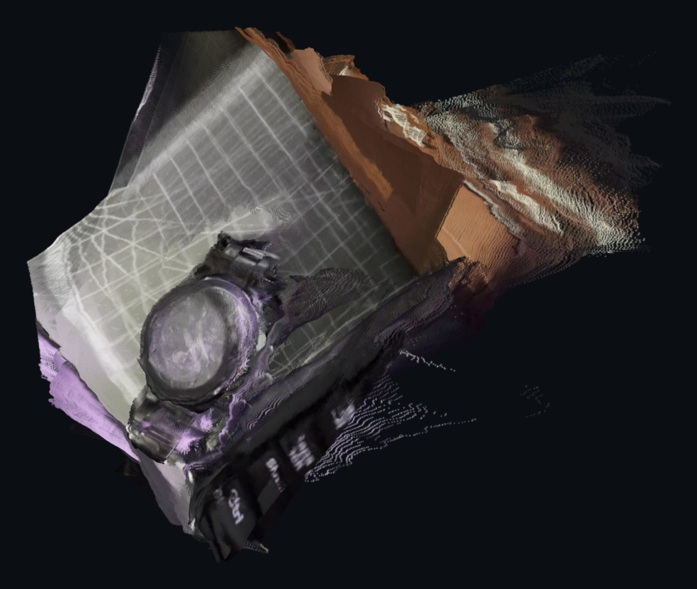
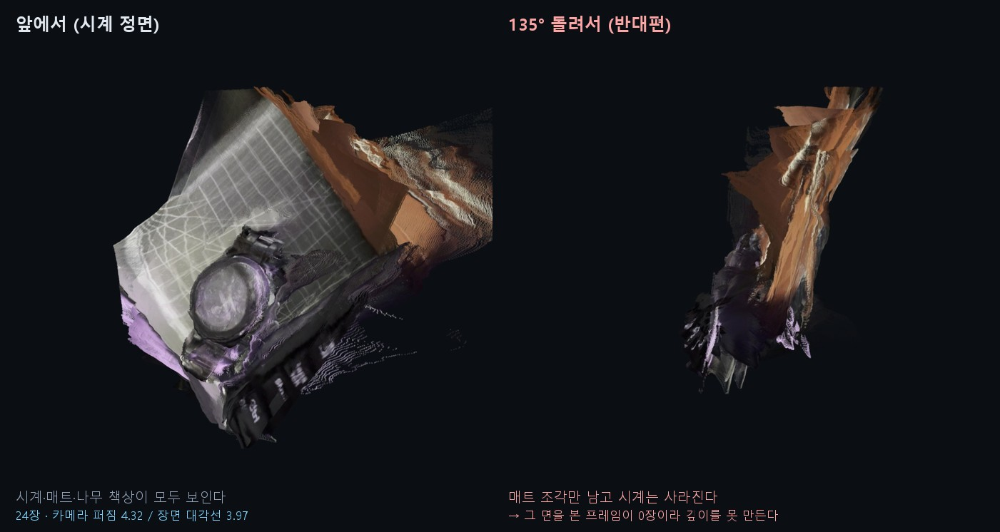

# 3D 뷰어 — 영상 하나에서 알갱이까지

**주소** https://eple-lab.github.io/3d-viewer/
**저장소** https://github.com/eple-lab/3d-viewer

폰으로 찍은 **16.2초짜리 영상 한 편**에서 3차원 장면을 복원하고, 브라우저가 바로
열 수 있는 **`.sog` 파일 하나**로 줄여서 웹에 올렸습니다. 링크만 누르면 앱 설치 없이
그 공간을 손가락으로 돌려 볼 수 있습니다.



---

## 공개 판단 — 남에게 보내도 되는 공간인가

> **공개 가능.** 화면에 나오는 것은 책상 위 **손목시계와 재단 매트, 키보드 자판**뿐입니다.
> 사람의 얼굴·차량 번호판·이름이 적힌 물건·화면에 뜬 개인 정보가 없고, 제3자의 사적
> 공간도 아닙니다. 시계는 상품이지 개인을 식별하는 정보가 아닙니다.

| 확인 항목 | 결과 |
|---|---|
| 사람 얼굴 | 없음 |
| 차량 번호판 | 없음 |
| 이름·전화번호·주소가 적힌 것 | 없음 |
| 모니터에 뜬 개인 정보 | 없음 |
| 남의 집·사무실 내부 | 아님 (개인 책상 위 물체) |

촬영 대상이 **공간이 아니라 물체**라는 점은 숨기지 않습니다. 아래 "한계" 절에
그로 인해 생기는 제약을 함께 적었습니다. 판단 기준은
[`docs/PUBLISHING.md`](docs/PUBLISHING.md) 에 체크리스트로 정리했습니다.

---

## 주소가 열리는가

### 1. 파일이 실제로 내려오는가

```
https://eple-lab.github.io/3d-viewer/scene.sog
```

이 주소를 새 탭에 붙여 넣으면 **파일이 다운로드됩니다.** (404 가 아니면 배포 성공)

```powershell
curl.exe -sI https://eple-lab.github.io/3d-viewer/scene.sog | Select-String "HTTP/|content-length"
```

### 2. 화면이 뜨는가

```
https://eple-lab.github.io/3d-viewer/
```

왼쪽 위에 다섯 단계가 차례로 `OK` 로 바뀝니다. 하나라도 `X` 가 뜨면 그 줄이
원인을 말해 줍니다. 화면 왼쪽 아래에는 **알갱이 수·파일 크기·알갱이당 바이트·장면
지름·fps** 가 표시됩니다.

### 3. 폰에서 되는가

| 기기 | 확인 |
|---|---|
| 아이폰 Safari | <!-- PHONE_IOS --> |
| 안드로이드 Chrome | <!-- PHONE_ANDROID --> |
| 셀룰러(와이파이 끔) | <!-- PHONE_CELL --> |

가로·세로 모두 열리고, 한 손가락으로 돌리고 두 손가락으로 당길 수 있습니다.

### 뷰어가 조용히 실패하지 않게 한 것

이 스택에는 **오류 없이 화면만 까매지는** 함정이 셋 있습니다. 셋 다 코드로 막고,
화면에 단계별로 표시했습니다.

| 함정 | 증상 | 처리 |
|---|---|---|
| `SparkRenderer` 를 `scene.add()` 안 함 | 까맣고 오류 없음 | 무조건 추가 + 2단계 표시 |
| `.sog` 인데 `fileType:"sog"` | `Invalid file type` | `pcsogszip` 로 매핑 |
| `Box3.setFromObject(splatMesh)` | 빈 상자 → 카메라가 딴 곳 | `getBoundingBox()` 우선 |

---

## 수치 — 무엇을 재고 얼마인가

T4 에서 24장으로 복원한 값입니다. 원본은 `data/measurements.json` 에 있습니다.

| 항목 | 값 | 어떻게 쟀나 |
|---|---|---|
| **카메라 퍼짐 / 장면 대각선** | **1.0880** (4.3219 / 3.9724) | 카메라 위치 경계 상자 대각선 ÷ 점 경계 상자 대각선 |
| 복원 점 | 3,578,759 → 3,496,815 (97.7%) | 마스크 통과 점에서 0.5~99.5 백분위 밖 제거 |
| **알갱이 수** | **3,496,815개** | 점 1개 = 알갱이 1개 |
| **알갱이당 바이트** | **68.00 B** | (237,783,837 − 417) ÷ 3,496,815 |
| `.ply` | 237.8MB | 기준 (68B/개) |
| `.splat` | 111.9MB | 2.1배 작음 |
| `.compressed.ply` | 56.9MB | 4.2배 작음 |
| **`.sog`** | **17.5MB** | **13.6배 작음** · 100MiB 의 16.7% |
| 복원 | 9.1초 · 최대 GPU 11.99GB | T4, 24장, fp16. 같은 조건의 앞선 실행은 6.74GB |
| 사진이 들어간 크기 | 518×294 | 원본 1920×1080 이 3.7배 축소 |

### 읽는 법

**퍼짐 비율 1.0880 은 "카메라가 장면 대각선보다 더 움직였다"는 뜻입니다.** 걷는
공간 촬영에서는 보통 0.2~0.4 가 나옵니다. 1 을 넘는 이유는 이 장면이 **공간이 아니라
물체**이고, 카메라가 물체 **가까이 붙어** 움직였기 때문입니다. 기준선 0.1 을 훨씬
넘으므로 삼각측량은 성립합니다.

다만 **퍼짐 비율은 "얼마나 움직였나"만 재고 "어디를 봤나"는 재지 않습니다.** 이
장면은 카메라가 앞쪽 호만 지나가서, 비율이 1 을 넘는데도 뒤쪽 면은 점이 하나도
없습니다(아래 "한계" 절 1번). 비율 하나로 품질을 판정하면 안 되는 이유입니다.

**알갱이당 68.00 바이트는 정확히 17칸 × 4바이트입니다.** 각도별 색 45칸(`f_rest`)이
헤더에 들어가지 않았다는 뜻이고, 들어갔다면 248B 가 되어 파일이 3.6배가 됩니다.

**형식별 크기에서 실용적인 결론이 하나 나옵니다.** 깃허브는 파일 하나에 100MiB 가
한계인데, `.ply`(237.8MB)와 `.splat`(111.9MB)은 **둘 다 거부됩니다.**
올릴 수 있는 것은 `.compressed.ply`(56.9MB)와 `.sog`(17.5MB)뿐이고, 그래서 `.sog` 를
골랐습니다. 압축 후 알갱이 하나가 **4.99바이트** — 원본의 7.3%입니다.

`MB` 는 1,000,000 으로 나눈 값입니다. 같은 파일을 1,048,576 으로 나누면
`.sog` 는 16.7MiB 로 찍힙니다. **도구마다 다르게 보이는 이유가 이것입니다.**

측정 정의와 재현 명령은 [`docs/MEASUREMENTS.md`](docs/MEASUREMENTS.md) 에 있습니다.
뷰어 화면 왼쪽 아래에도 같은 값이 실시간으로 표시되니, 문서와 대조해 보십시오.

---

## 한계 — 안 나온 자리는 왜 안 나왔나

검은 얼룩은 **복원된 점이 없는 자리**입니다. 렌더링 문제가 아닙니다.
점이 없는 이유는 둘뿐입니다.

```
(A) 시차 부족 — 그 면을 볼 수 있는 사진이 거의 없다 → 깊이를 못 잼
(B) 정렬 실패 — 카메라 자세가 틀어져 표면이 두 겹 → 빈 틈
```

### 이 장면에서 실제로 비는 자리

아래 다섯 자리는 뷰어를 직접 돌려 보면 확인됩니다. 그중 1번은 그림 한 장으로 못 박아
두었습니다 — **같은 장면을 135° 돌린 것**입니다.



| # | 자리 | 화면에서 보이는 것 | 원인 |
|---|---|---|---|
| 1 | **시계 뒷면·옆면** | 135° 돌리면 시계가 통째로 사라지고 매트 조각만 남는다 | (A) 시차 부족 — 그 면을 본 프레임이 **0장** |
| 2 | **시계 밑면**(매트에 닿은 면) | 아래에서 올려다보면(고도 −25°) 검은 구멍 | (A) 시차 부족 — 영상 내내 시계가 눕혀 있어 바닥면이 한 번도 안 나온다 |
| 3 | **시계 유리** | 흰 보랏빛 얼룩, 문자판이 안 읽힌다 | (A) 시차 부족 — 유리와 그 뒤 문자판이 한 화소에 겹쳐 깊이가 두 값으로 튄다 |
| 4 | **브레이슬릿 마디** | 점이 사슬처럼 늘어져 붓으로 칠한 것 같다 | (B) 정렬 실패 — 금속 반사면은 프레임마다 색이 달라 같은 점으로 안 묶인다 |
| 5 | **빠르게 지나간 구간** | 같은 방향으로 길게 번진 줄무늬 | (B) 정렬 실패 — 13번 프레임 선명도 3.55 는 중앙값 8.74 의 41% |

**1번과 2번이 이 장면의 성격을 결정합니다.** 영상은 시계를 책상에 눕혀 두고 그 위를
도는 구성이라, 카메라가 **앞쪽 호만** 지나갑니다. 카메라 퍼짐이 4.32 로 장면 대각선
3.97 보다 큰데도(비율 1.088) 뒤쪽 면이 없는 이유는 **움직인 거리가 아니라 움직인 방향**이
한쪽으로 쏠렸기 때문입니다. 퍼짐 비율은 "얼마나 움직였나"만 재고 "어디를 봤나"는 재지
않습니다. 그래서 퍼짐 비율이 1 을 넘는다고 해서 모든 면이 복원됐다고 말할 수 없습니다.

**3번은 시차가 0 에 가까운 경우입니다.** 깊이는 두 사진에서 같은 점이 얼마나 밀려
보이는지로 재는데, 유리는 뒤의 문자판을 비추면서 동시에 자기 반사를 갖습니다. 같은
화소에서 깊이가 두 값으로 갈리니 모델이 그 자리를 버립니다. **유리가 안 보이는 것이
아니라, 유리가 있는 자리에 점이 없는 것입니다.**

**4·5번은 반대로 시차는 충분한데 자세가 틀어진 경우입니다.** 표면이 두 겹으로 겹치면
그 사이에 틈이 남고, 그 틈이 검게 보입니다. 1~3번과 구분하는 방법은 **얼룩의 가장자리**입니다.
주변 색이 자연스럽게 이어지면 (A), 이중 윤곽이 보이면 (B)입니다.

### 보랏빛은 구멍이 아니라 색이 틀린 자리

영상 후반(19~23초)에는 유리에 **보랏빛 반사**가 잡힙니다
([접촉 시트](shots/contact-sheet.jpg) 마지막 줄). 각도별 색을 학습하지 않았으므로 그
반사가 **한 시점의 값으로 굳어** 있습니다. 그래서 반사가 없던 방향에서 돌려 봐도
유리와 베젤 테두리가 보랏빛으로 남습니다. 자리는 맞고 색만 틀린 경우이므로, 검은
구멍과 섞어서 읽으면 안 됩니다.

### 왜 압축 손실이 아닌가

`.sog` 의 알갱이 수는 **3,496,815개로 `.ply` 와 정확히 같습니다.** 압축은 점을 지우지
않고 위치·회전·색을 8비트로 양자화할 뿐입니다. 양자화는 점을 조금 옮길 수는 있어도
점을 없앨 수는 없습니다. **따라서 위의 구멍은 압축 전부터 있던 복원 손실입니다.**

같은 장면을 압축 전 파일로 보고 싶으면 노트북에서 `scene.ply` 를 받아 `?f=scene.ply`
로 열면 됩니다. 237.8MB 라 저장소에는 올릴 수 없습니다.

### 어떻게 구분하는가

| 얼룩의 모양 | 원인 |
|---|---|
| 가장자리가 부드럽고 주변 색이 이어짐 | (A) 시차 부족 |
| 이중 윤곽, 두 겹으로 겹침 | (B) 정렬 실패 |
| 칼같이 잘린 경계 | `mask_edges` 가 자른 자리 |
| 장면 전체가 활처럼 휨 | (B) 전역 정렬 실패 — 제자리 회전 촬영 |

더 자세한 원리와 이 장면의 자리별 설명은
[`docs/LIMITATIONS.md`](docs/LIMITATIONS.md) 에 있습니다.

---

## 어떻게 만들었나

```
영상 16.2초 → 사진 24장 → 점 → 알갱이 → .sog → 웹 주소
```

| # | 단계 | 도구 | 결과 |
|---|---|---|---|
| 1 | 조건 판정 | ffprobe | 1920×1080, 16.21초 |
| 2 | 프레임 24장 | ffmpeg `fps=24/길이` | 518×294 로 축소돼 들어감 |
| 3 | 복원 | MapAnything Apache-2.0, T4 fp16 | 점 + 카메라 24대 |
| 4 | 다듬기 | numpy 0.5~99.5 백분위 | 멀리 튄 점 제거 |
| 5 | 알갱이 | 17칸 × 4바이트 | 68B/개 |
| 6 | 축소 | splat-transform 3.10.3 | SOG v2 (Spark 2.1 호환) |
| 7 | 배포 | GitHub Pages | 정적, 빌드 없음 |

`index.html` 하나에 뷰어가 다 들어 있습니다. 빌드 도구가 없어서 `git push` 만으로
배포되고, 5년 뒤에도 열립니다. three.js 와 Spark 는 CDN 에서 가져옵니다.

---

## 저장소 구조

```
3d-viewer/
├── index.html              뷰어 (three.js + Spark)
├── scene.sog               알갱이 파일
├── .nojekyll               깃허브가 파일 이름을 손대지 않게
├── README.md               이 문서
├── data/
│   ├── video/watch.mp4     원본 영상
│   └── measurements.json   모든 수치
├── docs/
│   ├── PRD.md              요구사항과 수용 기준
│   ├── ARCHITECTURE.md     데이터 흐름과 파일 형식
│   ├── MEASUREMENTS.md     수치의 정의와 값
│   ├── LIMITATIONS.md      검은 얼룩 ↔ 시차·정렬
│   ├── PUBLISHING.md       공개 판단과 배포 절차
│   ├── CAPTURE.md          촬영 조건과 이번 영상 판정
│   └── RUNNING.md          Windows 에서 코랩 GPU 쓰기
├── notebook/room3d.ipynb   단계별 재현 노트북 (코드 + 설명)
├── shots/                  화면 캡처
└── scripts/                로컬 서버, sog 검사기, 코랩 실행
```

## 다시 만들어 보기

코랩에서 `notebook/room3d.ipynb` 를 위에서 아래로 실행하면 같은 것이 나옵니다.
런타임은 **T4 GPU**. 약 5분이고, 그중 3분이 가중치(4.91GB) 내려받기입니다.

로컬 미리보기:

```powershell
powershell -File scripts\serve.ps1      # http://localhost:8777
```

`file://` 로 열면 브라우저가 파일 읽기를 막습니다. 반드시 http 로 여십시오.

## 쓰는 것들

MapAnything Apache-2.0 · three.js MIT · Spark MIT · splat-transform MIT · Open3D MIT
